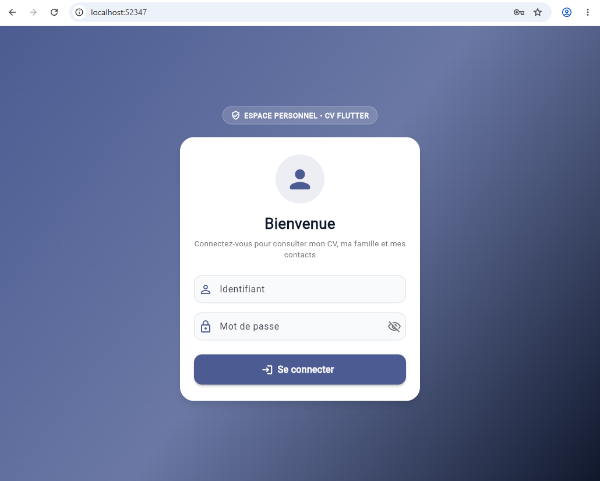
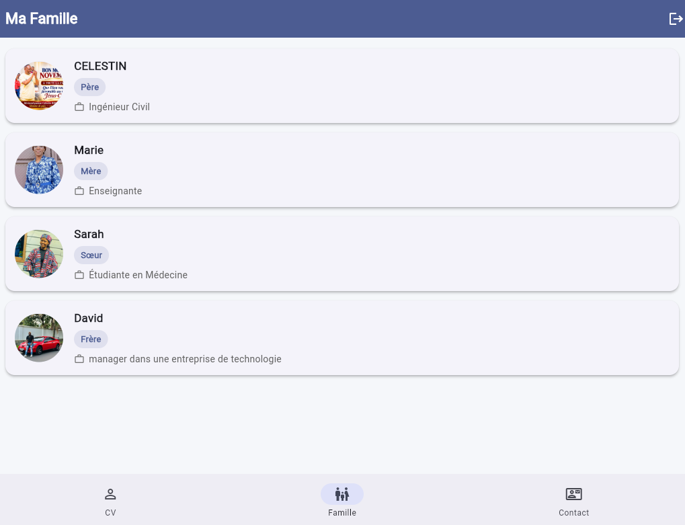
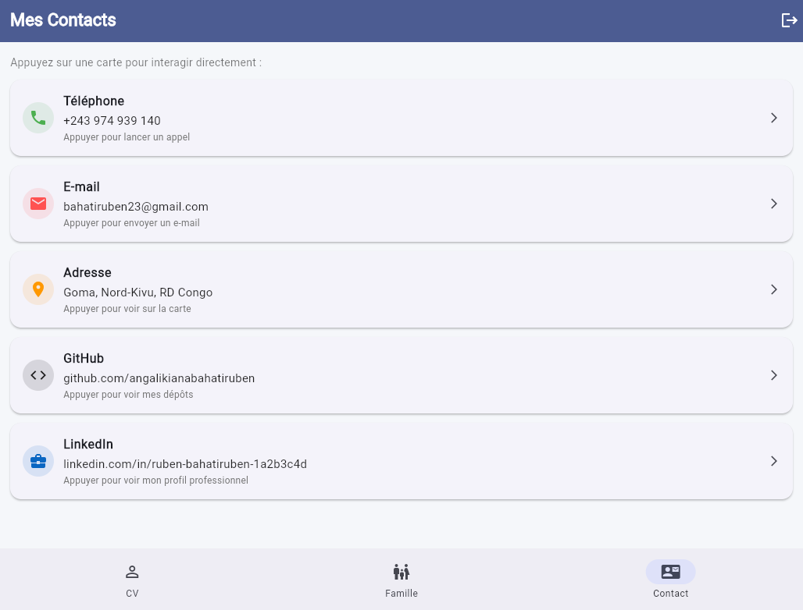

# Application Mobile CV - Flutter (`cv_flutter_ruben`)

Application développée avec **Flutter** dans le cadre d'un travail pratique (TP1 & TP2). Elle permet de consulter un Curriculum Vitae complet, d'accéder aux coordonnées interactives et de gérer dynamiquement les membres de la famille via une **API REST** (PHP / MySQL sur WampServer) après authentification.

## Démonstration vidéo
- Vidéo de démonstration (Ajout & gestion des membres de la famille) : [https://youtu.be/fdV2I0b18kc](https://youtu.be/fdV2I0b18kc)

## Fonctionnalités réalisées
- **Authentification réelle (API REST)** : Inscription (`/accounts/register`) et connexion (`/accounts/login`) avec validation des champs, masquage du mot de passe et gestion des erreurs.
- **Page Accueil (CV)** : Présentation complète (photo, profil, formation, expériences, compétences techniques, langues et centres d'intérêt).
- **Page Famille (CRUD dynamique)** : Consultation, ajout, modification et suppression des membres de la famille connectés à la base de données MySQL, avec sélection de photo compatible Web et mobile.
- **Page Contact** : Coordonnées interactives (appel téléphonique, envoi d'e-mail, géolocalisation, GitHub et LinkedIn via `url_launcher`).
- **Navigation** : Barre de navigation inférieure (`NavigationBar`) et bouton de déconnexion.

## Captures d'écran

| 1. Page de Connexion | 2. Page d'Accueil (CV - Partie 1) | 3. Page d'Accueil (CV - Partie 2) |
| :---: | :---: | :---: |
|  |  |  |

| 4. Page Famille | 5. Page Contacts |
| :---: | :---: |
|  |  |

## Installation et exécution

### 1. Backend (WampServer + `api-test`)
1. Démarrer **WampServer** (Apache sur le port `8080` et MySQL sur le port `3306`).
2. Placer le projet `api-test` dans `C:\wamp64\www\api-test`.
3. Créer la base de données `api` dans **phpMyAdmin** (`http://localhost:8080/phpmyadmin5.2.3/`) et importer `api.sql`.
4. Vérifier la configuration de la base de données dans `.env`.

### 2. Application Flutter
1. Cloner le dépôt :
   ```bash
   git clone [https://github.com/angalikianabahatiruben/cv_flutter_ruben.git](https://github.com/angalikianabahatiruben/cv_flutter_ruben.git)